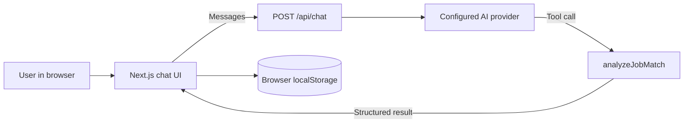

# ApplyPilot AI — Role Scout Agent

A responsive AI-assisted career workspace built as a Frontend AI Engineering capstone. ApplyPilot AI helps candidates discuss career preparation, compare their stated skills with the requirements of a job description, and identify areas to improve.

**Live application:** https://applypilot-ai-kappa.vercel.app  
**Repository:** https://github.com/ibrahim-codes1/applypilot-ai

> **Scope:** The Role Scout analyzes job descriptions supplied by the user. It does **not** search live job listings, upload resumes for automatic parsing, apply for jobs, or predict hiring outcomes.

## Features

- **Streaming AI career chat:** Interactive advice about resumes, interviews, job preferences, and application preparation, with stop/retry handling.
- **Role Scout workflow:** Prompts the user to provide skills and a job description, extracts relevant requirements, and asks for confirmation before presenting a match analysis in the guided workflow.
- **Structured Job Match card:** Displays a deterministic match percentage, matched requirements, and missing requirements through a state-aware tool-result interface.
- **Conversation persistence:** Saves a limited recent chat history in the current browser using `localStorage`; no user account is required.
- **Job preferences form:** Validated inputs, including optional salary and skills fields.
- **Responsive and accessible UI:** Mobile navigation, keyboard-accessible controls, labeled inputs, and status feedback.
- **CI and deployment:** Automated checks through GitHub Actions and hosting on Vercel.

## How the job match score works

The server-side `analyzeJobMatch` tool compares candidate skills with job requirements using **exact matching after normalization** (trim whitespace, lowercase, and collapse repeated spaces). Duplicate requirements are removed.

```text
match percentage = round(100 × matched unique requirements / total unique requirements)
```

**Example:**

| Candidate skills | Job requirements | Result |
|---|---|---|
| Flutter, Dart, Firebase | Flutter, Dart, REST APIs, Widget Testing | **50%** (2 of 4) |

Matched: Flutter, Dart. Missing: REST APIs, Widget Testing.

The percentage is a skills-coverage indicator—not a semantic similarity score or an estimate of the probability of receiving a job offer. The quality of the result depends on accurate user-supplied requirements. The AI-assisted extraction and confirmation steps are not a substitute for independent verification of inputs.

## Architecture



**Core components**

| Path | Purpose |
|---|---|
| `next-app/app/chat/page.jsx` | Chat route and provider status |
| `next-app/components/chat-workspace.jsx` | Client-side streaming interface |
| `next-app/components/job-match-tool-card.jsx` | Structured tool result UI |
| `next-app/app/api/chat/route.js` | Server-side chat endpoint and tool integration |
| `next-app/lib/tools/job-match.js` | Validated deterministic skill matching |
| `next-app/tests/` | Component, validation, and end-to-end tests |

**Stack:** Next.js 16, React 19, JavaScript, Tailwind CSS 4, AI SDK, Zod, Vitest, React Testing Library, Playwright, GitHub Actions, Vercel.

## Run locally

Requires **Node.js 20.9 or newer**.

```bash
cd next-app
npm install
```

Create `next-app/.env.local` from `next-app/.env.example` and configure **one** AI provider on the server.

**Google Gemini example:**

```dotenv
AI_PROVIDER=google
GOOGLE_GENERATIVE_AI_API_KEY=YOUR_KEY_HERE
GOOGLE_MODEL=gemini-2.5-flash
```

**Alternative:** Set `AI_PROVIDER=anthropic`, `ANTHROPIC_API_KEY`, and optionally `ANTHROPIC_MODEL` instead. Do **not** place secrets in `NEXT_PUBLIC_` variables or commit `.env.local`.

```bash
npm run dev
```

Open `http://localhost:3000/chat`. For a production-mode local check:

```bash
npm run build
npm run start
```

## Test commands

Run from `next-app/`:

```bash
npx vitest run
npx playwright test
npm run build
npm run lint
```

The repository also provides a focused chat validation script:

```bash
npm run test:chat
```

**Last verified locally (November 13, 2026):** Vitest **15/15 passing** across three files, Next.js production build **successful**. A Playwright E2E test passed in an earlier local run (**1/1**); rerun before final submission to confirm the current revision. The E2E test uses a mocked AI response and does not independently verify the external provider.

## Accessibility and performance evidence

- Keyboard-only navigation, visible focus, and Enter activation: **passed** in manual testing.
- Windows Narrator announced the chat input label and Send button: **passed** in a manual check.
- WAVE audit on `/chat`: **0 automated errors**, **0 contrast errors**, **3 redundant-link alerts** (to review); WAVE reports are not a complete WCAG conformance assessment.
- Lighthouse Mobile Accessibility on a clean `/chat` session: **96/100**; Best Practices **96/100**; SEO **100/100**.
- Lighthouse Mobile dashboard Performance reached **85/100** in one local production-mode run after a navigation prefetch change. The chat page was **76/100** in a clean-session baseline. A Markdown lazy-loading experiment scored **61/100** and was rolled back. **The chat performance target of 85+ remains unverified/not met**, and a post-rollback retest is still outstanding. Lighthouse results vary by run and hardware.

See [Capstone Test & Deployment Report](next-app/CAPSTONE_TEST_REPORT.md) for details.

## Deployment

Deployed through GitHub and Vercel. The latest **Production** deployment was verified **Ready** on November 13, 2026, from the `main` branch at merge commit **`0b93135`**. That confirms deployment status, **not** a fully verified end-to-end live AI flow. A production Role Scout smoke test and secret/configuration review are still pending.

See [deployment instructions](next-app/DEPLOYMENT.md) and the [release checklist](next-app/RELEASE_CHECKLIST.md).

## Known limitations and next steps

- No live job-board integration, account system, or automated job applications.
- Matching uses normalized exact string comparison; equivalent skills with different names may not match.
- AI-assisted requirement extraction and confirmation still need stronger server-side provenance and confirmation enforcement. Prompt-injection resilience has only been sampled in manual tests, not proven.
- Browser-local chat history is device/browser specific and may be lost when local storage is cleared.
- Production runtime rate limiting, secret/configuration auditing, error monitoring, and the live Role Scout smoke test require final verification.
- Chat initial-load performance needs profiling and a reliable, repeated mobile audit.
- The dashboard still contains some older FE-06-era feature descriptions; update copy to distinguish available Role Scout matching from unimplemented live job search.

## Project documentation

- [FE-06 chat notes](next-app/FE06_README.md)
- [FE-07 tool calling notes](next-app/FE07_README.md)
- [Role Scout build log](next-app/FL07_BUILD_LOG.md)
- [Test results](next-app/TEST_RESULTS.md)
- [Capstone test and deployment report](next-app/CAPSTONE_TEST_REPORT.md)
- [Capstone reflection and evidence](next-app/CAPSTONE_REFLECTION.md)
- [Release checklist](next-app/RELEASE_CHECKLIST.md)

## License

See [LICENSE](LICENSE).
